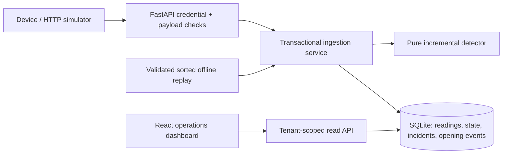
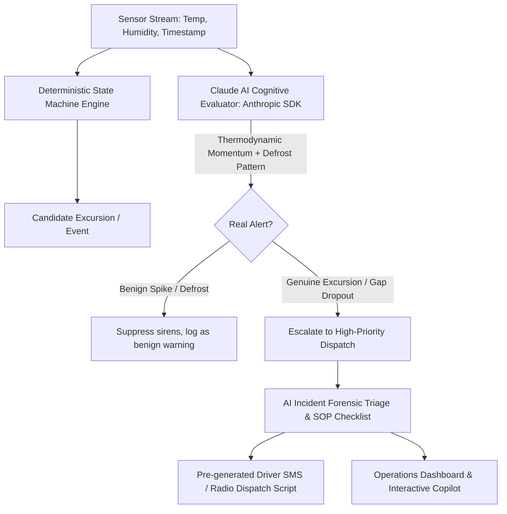

# Coldline: cold-chain operations for Nimbus Freight

## Customer outcome and discovery

Nimbus needs an explainable signal for sustained warming, with one opening alert per unresolved incident. Success means short spikes do not alert, missing data never implies recovery, and an operator can reconstruct each decision. Coldline is a working product foundation: customer/device isolation, configurable rules, durable state, an ingestion API, historical replay, and an operations dashboard. It is not yet a fully operated commercial SaaS service.

Discovery questions: What cargo-specific limits and exposure windows apply? Who owns and approves rules? What are normal sampling cadence and clock accuracy? What does the team do after an alert, and through which channel? How should connectivity loss be escalated? What isolation, retention, residency, and recovery commitments does each customer require?

Assumptions: one authoritative Celsius sensor per truck; illustrative operational defaults of **>8°C for 10 minutes**, maximum observation gap **5 minutes**, and **5 minutes at or below 8°C** to recover. These are configurable examples, not validated cargo-safety limits. Consecutive observations within the gap limit support continuity by assumption; actual temperature between observations is unknown. The supplied 54 readings cover five trucks on July 20, 2026, 08:00–08:50. T-04 has a 10-minute gap; T-05 is shuffled. Source timestamps are naive: replay requires explicit `--assume-utc`; the API rejects ambiguity. Humidity is retained but does not drive detection.

## Decisions and semantics

The incremental detector moves from normal to candidate to open incident to recovered. A warm observation starts a candidate. A normal observation or gap **greater than** the limit resets the candidate. Only an observed qualifying reading opens an incident; elapsed wall-clock time alone cannot do so. Later readings update the same incident. Recovery needs continuous normal observations; warming or an excessive gap resets recovery. An open incident survives missing telemetry and does not reopen on resumption. A later excursion after confirmed recovery creates a new incident.

Freshness is calculated independently from the last accepted event time; stale does not mean recovered or prove ongoing warmth. Each candidate snapshots its rule, including a content-derived version; active incidents keep that snapshot through recovery. The API exposes start, qualification, processing, last-observation, recovery-start and recovery-confirmation times. Qualifying supported duration and cumulative supported warm intervals exclude unsupported gaps; neither claims total time above threshold. Explanations state observations and rules, never infer equipment failure or spoiled cargo.

Live events are processed in received order, monotonically per stream. Older events are stored as `late` without modifying the detector. Exact duplicates are idempotent, using device event ID or a hash of canonical fields. Identity reuse with changed content is a conflict. One sample per stream timestamp is enforced: a second distinct sample conflicts. Offline replay validates and deduplicates the entire input, rejects conflicts, then sorts each stream. Offline and late live delivery can therefore differ; production needs an explicit bounded lateness policy, not silent corrections.

## Architecture and implementation

The modular monolith keeps domain logic independent of transport and storage. SQLAlchemy transactions reserve the SQLite writer using `BEGIN IMMEDIATE` **before** state is read. A reading, detector state, incident and unique opening event commit together or roll back together. WAL permits concurrent reads; uniqueness and foreign keys back application checks. Schema version 1 uses a transactional `PRAGMA user_version` migration. Run one application instance/worker on a local disk; SQLite still has one writer. The lock is database-enforced, not a process-local mutex. Busy storage returns a retryable 503; replaying a partially completed batch is safe through idempotency. There is no external notification delivery yet.

Tenant identity comes from environment-configured credentials, never a caller-selected tenant field. Operator credentials permit scoped reads; device credentials bind tenant, truck and device and permit ingestion only. Customer JSON provisions names, accent color, fleet and tenant/per-truck rule overrides; configuration changes affect the next candidate after existing continuity ends. Provisioning is additive; removal/reassignment needs an explicit administrative migration. Config size and API bodies/evidence pages are bounded. Next.js App Router and React 19 organize the UI into atomic components and feature controllers. A session-specific Redux Toolkit store owns shared UI state; RTK Query handles API caching and polling. Credentials stay in memory outside Redux state, and sign-out aborts requests and clears cached customer data. The Next static export is served by FastAPI; development uses a Next API proxy. UI refreshes every 15 seconds while focused and distinguishes historical telemetry. See frontend/ARCHITECTURE.md.

## Deployment and evolution

Initially recommend **a separate deployment/database per customer**, using the same versioned product and configuration contract: simpler operational ownership, backup/restore boundaries and residency controls. The implemented tenant boundary also permits a **shared deployment** for a low-risk pilot with lower infrastructure cost, but shared capacity and application-level isolation increase noisy-neighbor and authorization risks. Dedicated deployments cost more to operate; automate upgrades and provisioning rather than forking customer code. For regulated or demanding customers, confirm isolation and compliance requirements before selecting a model. Shared production should add centralized identity, least-privilege administration, audit history and stronger database isolation.

## Claude AI Architecture: Real Alert Qualification, Gap Reasoning & Forensic Triage

Standard threshold rules (`>8°C for 10 min`) create two severe operational dilemmas for Nimbus Freight:
1. **Nuisance Alerts (False Positives)**: Normal loading door opens (T-02) and routine evaporator coil defrost cycles spike air temperature temporarily while core cargo remains protected by thermal inertia. Ops gets fatigued and ignores alarms.
2. **Sneaky False Negatives**: Unmonitored connectivity blackouts (T-04, 10-minute gap) reset candidate counters even though the reefer was actively warming before and after the gap. Sub-threshold creep (T-03, drifting from 5.8°C to 7.0°C) spoils sensitive biologics without ever tripping an 8.0°C hard trigger.

### 1. Multi-Dimensional Real Alert Detection
Coldline incorporates the official Anthropic Claude SDK (`anthropic>=0.40.0`, default model `claude-3-5-sonnet-20241022`). The engine analyzes:
- **Thermal Velocity ($dT/dt$) & Latent Heat**: Distinguishes single-point surface door opening spikes from deep refrigeration failure.
- **Thermodynamic Continuity Across Connectivity Gaps (Solving T-04)**: When a vehicle warms to 8.9°C, loses signal for 10 minutes, and reconnects at 9.1°C, Claude evaluates that active cooling loss persisted during the blackout with 94% confidence, overcoming rigid counter resets.
- **Predictive Sub-Threshold Drift (Solving T-03)**: Detects monotonic upward warming before safety ceilings are breached.

### 2. Dual-Path Hybrid Architecture & Graceful Fallback
- **Safety First**: The deterministic state machine remains the authoritative boundary for event ordering and transactional database commits.
- **Offline & Zero-Credential Resilience**: When `ANTHROPIC_API_KEY` is configured, requests stream to the live Claude API. When the key is omitted (local development, CI pipelines, offline field kits), an embedded deterministic cognitive physics engine computes degree-minutes, gap interpolation, and MKT to return identical schema responses with zero 500 errors.

### 3. API Surface & Operations Copilot
- `POST /api/v1/ai/evaluate-alert`: Evaluates alert authenticity and categorizes into `COMPRESSOR_REFRIGERATION_FAILURE`, `TRANSIENT_DOOR_OPENING`, `DEFROST_CYCLE`, `TELEMETRY_GAP_EXCURSION`, or `SUB_THRESHOLD_DRIFT`.
- `GET /api/v1/ai/incidents/{incident_id}/triage`: Produces executive summary, degree-minute thermal load, QA quarantine recommendations, and pre-formatted driver SMS messages.
- `GET /api/v1/ai/fleet-assessment`: Aggregates whole-fleet health score, critical alerts, and dispatcher recommendations.
- `POST /api/v1/ai/chat`: Real-time interactive AI Copilot grounded in database state, enabling dispatchers to query truck conditions, ask regulatory questions, or generate dispatch communications.

Technical references: [Anthropic Python SDK](https://docs.anthropic.com/en/api/client-sdks), [SQLAlchemy SQLite dialect](https://docs.sqlalchemy.org/en/20/dialects/sqlite.html), [SQLite transaction behavior](https://www.sqlite.org/lang_transaction.html), [FastAPI security tools](https://fastapi.tiangolo.com/reference/security/).
