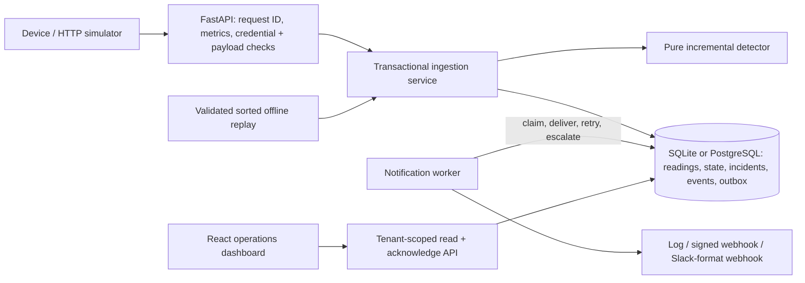
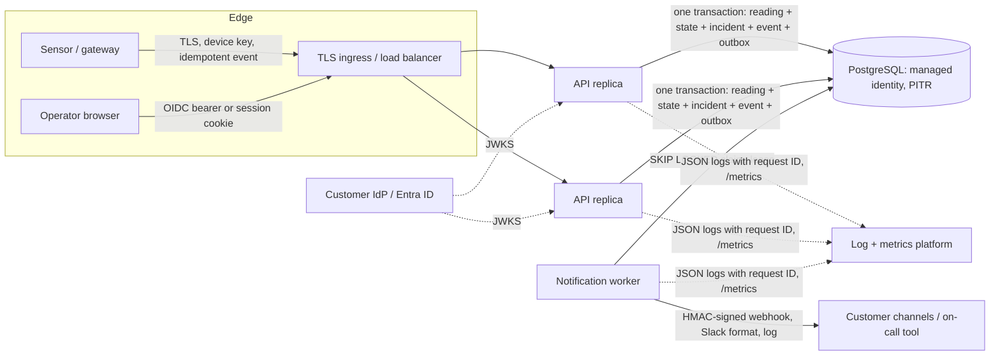
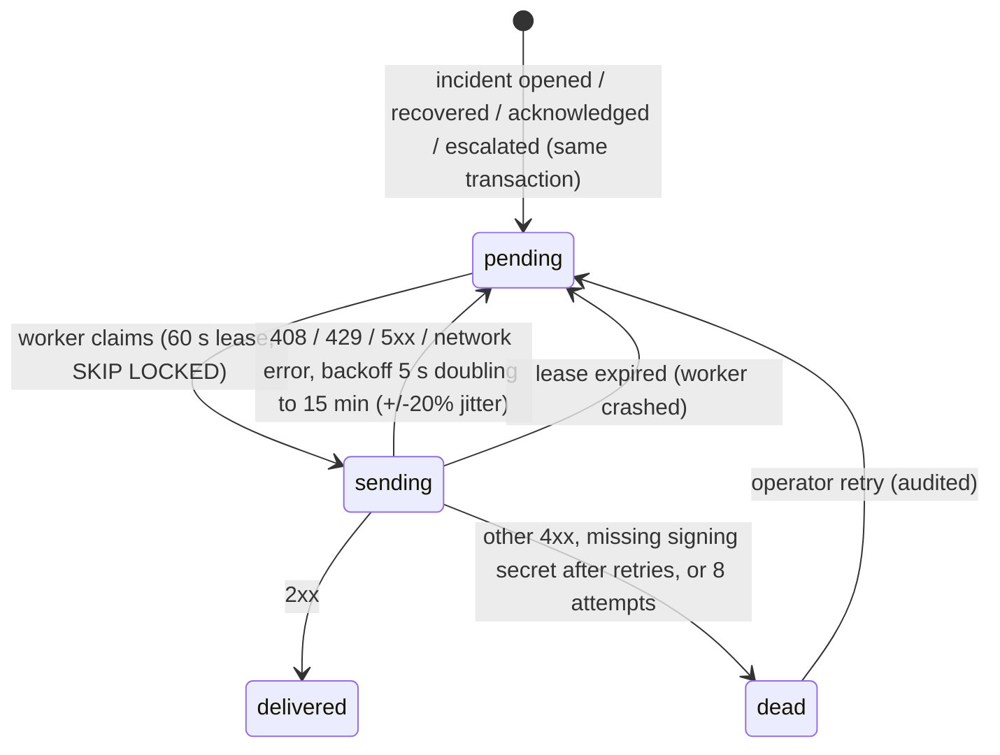

# Coldline: cold-chain operations for Nimbus Freight

## Customer outcome and discovery

Nimbus needs an explainable signal for sustained warming, with one opening alert per unresolved incident. Success means short spikes do not alert, missing data never implies recovery, and an operator can reconstruct each decision. Coldline is a working product foundation: customer/device isolation, configurable rules, durable state, an ingestion API, historical replay, and an operations dashboard. It is not yet a fully operated commercial SaaS service.

Discovery questions: What cargo-specific limits and exposure windows apply? Who owns and approves rules? What are normal sampling cadence and clock accuracy? What does the team do after an alert, and through which channel? How should connectivity loss be escalated? What isolation, retention, residency, and recovery commitments does each customer require?

Assumptions: one authoritative Celsius sensor per truck; illustrative operational defaults of **>8°C for 10 minutes**, maximum observation gap **5 minutes**, and **5 minutes at or below 8°C** to recover. These are configurable examples, not validated cargo-safety limits. Consecutive observations within the gap limit support continuity by assumption; actual temperature between observations is unknown. The supplied 54 readings cover five trucks on July 20, 2026, 08:00–08:50. T-04 has a 10-minute gap; T-05 is shuffled. Source timestamps are naive: replay requires explicit `--assume-utc`; the API rejects ambiguity. Humidity is retained but does not drive detection.

## Decisions and semantics

The incremental detector moves from normal to candidate to open incident to recovered. A warm observation starts a candidate. A normal observation or gap **greater than** the limit resets the candidate. Only an observed qualifying reading opens an incident; elapsed wall-clock time alone cannot do so. Later readings update the same incident. Recovery needs continuous normal observations; warming or an excessive gap resets recovery. An open incident survives missing telemetry and does not reopen on resumption. A later excursion after confirmed recovery creates a new incident.

Freshness is calculated independently from the last accepted event time; stale does not mean recovered or prove ongoing warmth. Each candidate snapshots its rule, including a content-derived version; active incidents keep that snapshot through recovery. The API exposes start, qualification, processing, last-observation, recovery-start and recovery-confirmation times. Qualifying supported duration and cumulative supported warm intervals exclude unsupported gaps; neither claims total time above threshold. Explanations state observations and rules, never infer equipment failure or spoiled cargo.

Live events are processed in received order, monotonically per stream. Older events are stored as `late` without modifying the detector. Exact duplicates are idempotent, using device event ID or a hash of canonical fields. Identity reuse with changed content is a conflict. One sample per stream timestamp is enforced: a second distinct sample conflicts. Offline replay validates and deduplicates the entire input, rejects conflicts, then sorts each stream. Offline and late live delivery can therefore differ; production needs an explicit bounded lateness policy, not silent corrections.

## Architecture and implementation

The modular monolith keeps domain logic independent of transport and storage. Each reading is processed in one database transaction that locks the truck's state before reading it: SQLite reserves the writer with `BEGIN IMMEDIATE`; PostgreSQL uses `SELECT ... FOR UPDATE` on the truck row, so concurrent API replicas serialise per truck rather than globally. The reading, detector state, incident, the incident timeline event and any notification outbox rows commit together or roll back together. Schema version 2 is additive over version 1 and is applied on start-up under a PostgreSQL advisory lock (`PRAGMA user_version` plus a `schema_meta` row record the version; a newer, unknown schema is refused). Busy storage returns a retryable 503; replaying a partially completed batch is safe through idempotency.

Tenant identity comes from configured credentials or a verified OIDC token, never a caller-selected tenant field. Operator credentials permit scoped reads and incident acknowledgement; device credentials bind tenant, truck and device and permit ingestion only. Customer JSON provisions names, accent color, fleet, tenant/per-truck rule overrides and notification channels/escalation; configuration changes affect the next candidate after existing continuity ends. Provisioning is additive; removal/reassignment needs an explicit administrative migration. Config size and API bodies/evidence pages are bounded. Next.js App Router and React 19 organize the UI into atomic components and feature controllers. A session-specific Redux Toolkit store owns shared UI state; RTK Query handles API caching and polling. Credentials stay in memory outside Redux state, and sign-out aborts requests and clears cached customer data. The Next static export is served by FastAPI; development uses a Next API proxy. The UI refreshes every 15 seconds while focused (5 seconds in the labelled live simulation) and distinguishes historical telemetry. See frontend/ARCHITECTURE.md.

## Deployment and evolution

Initially recommend **a separate deployment/database per customer**, using the same versioned product and configuration contract: simpler operational ownership, backup/restore boundaries and residency controls. The implemented tenant boundary also permits a **shared deployment** for a low-risk pilot with lower infrastructure cost, but shared capacity and application-level isolation increase noisy-neighbor and authorization risks. Dedicated deployments cost more to operate; automate upgrades and provisioning rather than forking customer code. For regulated or demanding customers, confirm isolation and compliance requirements before selecting a model. Shared production should add centralized identity, least-privilege administration, audit history and stronger database isolation.

## Product architecture

Coldline is a **modular monolith with a separately scalable worker role**. The same image runs as an API replica (`serve`) or a notification worker (`worker`); both are stateless and share one database. The deterministic detector remains the only component that opens or recovers an incident.

| Concern | Implemented design | Production deployment |
| --- | --- | --- |
| Alert delivery | Transactional outbox written in the ingest transaction; worker delivers at-least-once | Run `backend.cli worker` as its own deployment; set `COLDCHAIN_NOTIFICATION_WORKER=0` on API replicas |
| Human response | Idempotent acknowledgement with note, actor and time; immutable incident timeline | Map acknowledgement to the customer's on-call tool through webhooks |
| Escalation | Per-tenant levels (minutes after opening) fire once each until acknowledged | Customer chooses channels, delays and quiet hours |
| Horizontal scale | DB-backed operator sessions (hashed tokens), per-truck row locks, advisory-locked migrations/provisioning | PostgreSQL via `COLDCHAIN_DATABASE_URL`; any number of API replicas |
| Identity | API keys for devices and integrations, password sessions for pilots, OIDC JWT verification (RS256/ES256, issuer, audience, tenant and role claims) | Entra ID or another OIDC IdP; managed identity token for PostgreSQL (`COLDCHAIN_DB_AUTH=azure-managed-identity`) |
| Observability | JSON logs, `X-Request-ID` propagation, Prometheus `/metrics`, `/health` (liveness) and `/ready` (DB + worker) | Scrape with a metrics token; alert on dead-lettered notifications and `/ready` failures |
| Backup and recovery | SQLite online backup with integrity check and SHA-256 manifest; verify and guarded restore | PostgreSQL point-in-time recovery plus scheduled restore drills |

### Notification delivery and acknowledgement

- **Atomicity:** outbox rows are inserted in the ingest transaction, so an incident can never exist without its notification, and a rolled-back ingest never notifies. Rows are unique per tenant, incident, event and channel.
- **At-least-once:** a crash after delivery but before marking can resend. Receivers de-duplicate on `X-Coldline-Delivery`. Webhooks carry `X-Coldline-Event`, `X-Coldline-Timestamp` and `X-Coldline-Signature: v1=HMAC-SHA256(secret, "<timestamp>." + body)`. The secret is read from the environment variable named by the channel's `secret_env`; it is never stored in configuration. Redirects are not followed.
- **Acknowledgement:** `POST /api/v1/incidents/{id}/acknowledge` records who acknowledged and when, with an optional note. It is idempotent; a second call returns the original acknowledgement. Acknowledging stops escalation but does **not** close the incident. Only observed recovery closes it.
- **Escalation:** the worker evaluates open, unacknowledged incidents against `notifications.escalation` levels (minutes after the incident was processed). Each level fires once and is recorded in the timeline.
- **Operator visibility:** the incident dialog shows the acknowledgement form, timeline and per-channel delivery status. `GET /api/v1/notifications` lists deliveries, and `POST /api/v1/notifications/{id}/retry` re-queues dead letters.

### Multi-instance operation

SQLite remains the zero-dependency default for local use and single-site pilots, and it is still single-writer and single-host. With `COLDCHAIN_DATABASE_URL=postgresql+psycopg://...`, the same code runs as multiple replicas:

- **Sessions:** browser sessions live in `operator_sessions` (SHA-256 token hash, absolute expiry), so any replica can serve any request. Sign-out revokes the session everywhere.
- **Write correctness:** ingestion locks the truck row, which serialises one truck's stream while different trucks proceed in parallel. The worker claims outbox rows with `FOR UPDATE SKIP LOCKED`, so several workers do not deliver the same row concurrently.
- **Start-up:** migration and provisioning take a PostgreSQL advisory lock, so replicas can start together.
- **Per-process state:** login throttling and in-process metric counters are per replica. Aggregate metrics in the monitoring platform. Rate limiting at the ingress is recommended for internet-facing deployments.
- **Not verified here:** PostgreSQL behaviour is covered by dialect-aware code and SQL compilation, but this repository's automated tests run on SQLite. Run the suite against a staging PostgreSQL instance before the first multi-instance deployment.

### Identity and secrets

- **OIDC:** when `COLDCHAIN_OIDC_ISSUER`, `COLDCHAIN_OIDC_AUDIENCE` and `COLDCHAIN_OIDC_JWKS_URL` are set, `Authorization: Bearer <JWT>` is verified against the IdP's JWKS. Only RS256 and ES256 are accepted. The token must have the configured issuer and audience, the operator role (`roles` contains `coldline.operator` by default), and a tenant claim (`coldline_tenant`) naming a provisioned tenant. Local accounts become optional.
- **Browser CSRF:** cookie-authenticated mutations require the `X-Coldline-Request: browser` header, which a cross-site form cannot send. Cookies are HttpOnly and SameSite.
- **Database:** `COLDCHAIN_DB_AUTH=azure-managed-identity` obtains a short-lived Entra token for each new PostgreSQL connection. This requires the optional `azure-identity` package and removes stored database passwords.
- **Secrets:** device and operator keys, webhook signing secrets and metrics tokens come from the environment. In production, inject them from a managed secret store and rotate them there.

### Observability and operations

- **Logging:** with `COLDCHAIN_LOG_FORMAT=json`, logs are one JSON object per line. Each line carries a request ID, which is generated or taken from a validated `X-Request-ID` header and echoed in the response.
- **Metrics:** `/metrics` exposes request counts and latency by route template, readings by outcome, incident transitions, notification attempts, escalations and acknowledgements, plus gauges for open incidents, outbox backlog, dead letters and worker cycle age. It can be protected with `COLDCHAIN_METRICS_TOKEN`.
- **Suggested alerts:** `/ready` failing, `coldline_outbox_dead` above zero, a growing `coldline_outbox_pending`, and a rising 5xx rate.
- **Probes:** `/health` is liveness only. `/ready` checks the database schema version and that the hosted worker is cycling; it is the container healthcheck.

### Backup, recovery and targets

- **SQLite:** `python -m backend.cli backup` uses SQLite's online backup API, runs `PRAGMA integrity_check`, and writes a manifest with SHA-256, schema version and row counts. `verify-backup` re-checks a copy. `restore` refuses to overwrite an existing database without `--force` and rejects backups from a newer schema. Schedule backups and copy them off-host.
- **PostgreSQL:** use managed point-in-time recovery and geo-redundant backups. The CLI deliberately refuses SQLite-style backups for PostgreSQL URLs.
- **Proposed targets (confirm with the customer):** RPO of 5 minutes and RTO of 1 hour for the pilot, demonstrated by a quarterly restore drill.
- **Delivery after recovery:** incidents, timeline and pending outbox rows are all in the database, so pending notifications resume after a restore. The database is the single recovery unit.

### Live demo: genuine and non-genuine alert simulation

The labelled live simulation (`python run.py --live`, or `--live --baseline steady` so that only injected patterns excurse) exposes a **Simulate a real-time pattern** panel. Scenario steps are generated from the truck's own rule, so the expected outcome holds for any configured threshold or window.

| Scenario | Genuine? | Expected detector outcome |
| --- | --- | --- |
| Compressor failure | Yes | Incident opens after the sustained window, then recovers |
| Marginal sustained excursion | Yes | Incident opens; a small magnitude does not suppress a sustained breach |
| Door-open spike | No | No incident; the spike returns below threshold before the window |
| Single-sample sensor glitch | No | No incident; one sample cannot prove sustained warming |
| Warm readings broken by a telemetry gap | No | No incident; continuity is unproven and data quality should be reviewed |

The simulator is an ordinary API client. It ingests through device keys, and the operator records each run (queued, then running, then completed or cancelled). The UI compares the expected outcome with the incident actually observed during the run and flags any mismatch. Scenarios are disabled for tenants that are not in live-simulation mode and while a truck has an open incident.

### Supply-chain note

`npm audit` reports a high-severity advisory in `braces` (GHSA-vfj7-8cjw-p6xm). It is reached only through `eslint-config-next`, then `fast-glob`, then `micromatch`, and no patched `micromatch` release exists. It affects development linting only: `npm run audit:prod` reports zero vulnerabilities, and the runtime image contains no Node dependencies. This is an accepted, documented risk, to be re-checked when upstream publishes a fix.

### AI and safety boundary

The AI-labelled features are deterministic evidence summaries and are not part of the safety decision. Runtime assessments are tenant-scoped, and no telemetry is sent to an external model. Gaps are explicitly unconfirmed, causes and cargo disposition are not inferred, and release decisions remain with the customer's qualified quality process. Before considering a language model, establish customer consent and data residency, a validated output schema, provenance and a failure policy. Any model must stay advisory and out of alert qualification.

### Decisions still owned by the customer

The mechanisms are implemented; the customer must still choose the policy values:

- the actual destination channels (on-call tool, Teams/Slack, email or SMS gateway behind a webhook)
- escalation timings and quiet hours
- who may acknowledge
- product-specific thresholds and units
- retention and residency
- event volume
- RPO/RTO
- dedicated versus shared environments

The 8°C/10-minute rule is an example for the supplied case data, not a validated safety specification.
